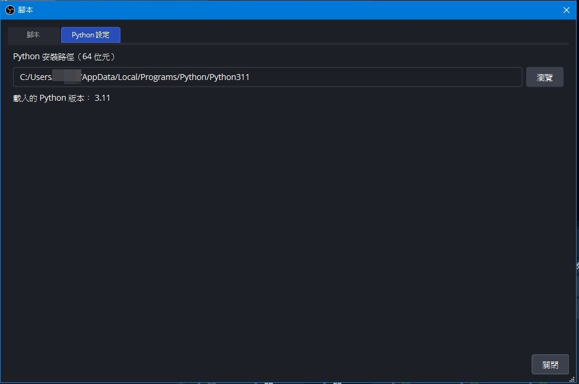
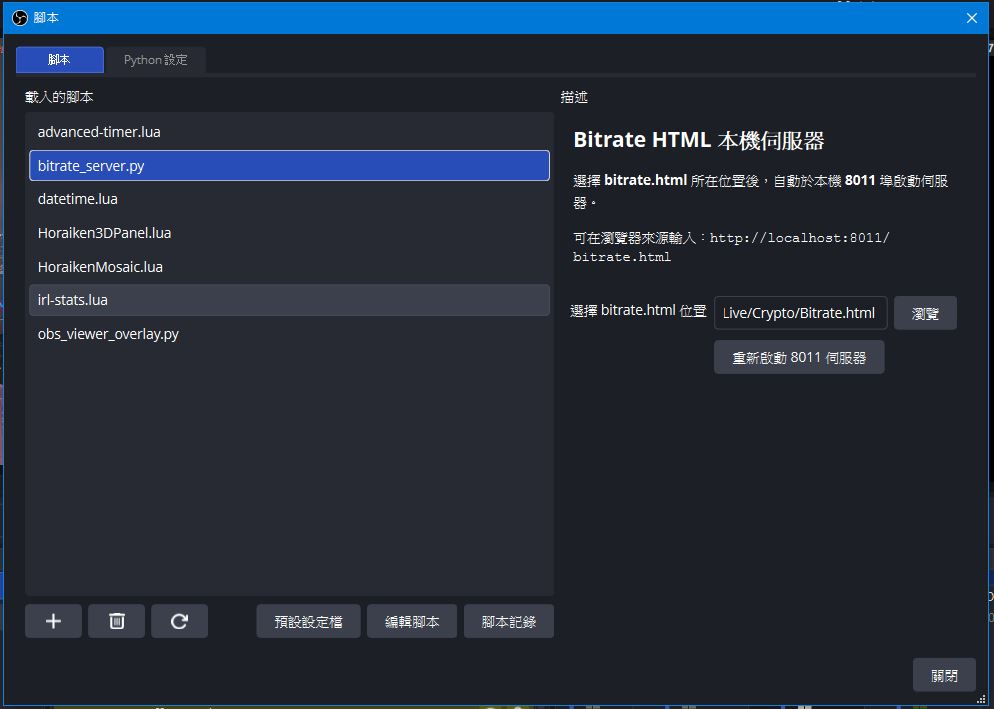

# MediaMTX-server-bitrate-html

##### HTML for OBS overlay that shows current bitrate of MediaMTX RTMP & SRT servers.

---
Setup Instructions:

Method 1:
1. Set the OBS bitrate overlay URL to: http://127.0.0.1:8080/Bitrate.html

2. Enable the MediaMTX Control API by setting api: true.

3. In the MediaMTX Control API configuration, change apiAllowOrigins: [] to apiAllowOrigins: ["*"]

4. Place the Start_Bitrate_Server.bat startup file in the same folder as Bitrate.html (please rename the downloaded Bitrate_EN.html to Bitrate.html), then double-click Start_Bitrate_Server.bat. Once you see that the HTTP Server has started, the OBS bitrate overlay is ready to use.

Method 2:
1. Modify the MediaMTX Control API setting: api: true

2. Change apiAllowOrigins: [] in the MediaMTX Control API settings to apiAllowOrigins: ["*"]

3. Download bitrate_server.py and add it to OBS Scripts.

4. Go to OBS Scripts -> Python Settings, select the folder where python.exe is located (e.g., C:/Users/<Username>/AppData/Local/Programs/Python/Python311). Installing Python 3.11 is recommended.

5. Once successful, you will see: Loaded Python Version: 3.11

6. Go back to the bitrate_server.py script settings and select the location of bitrate.html.

7. Set the OBS bitrate overlay URL to: [http://127.0.0.1:8011/Bitrate.html](http://127.0.0.1:8011/Bitrate.html), and click Refresh cache of current page.

# 使用設定：

方法1：
1. 設定OBS bitrate overlay網址：http://127.0.0.1:8080/Bitrate.html

2. 修改MediaMTX Control API , api: true

3. MediaMTX Control API apiAllowOrigins: [] 改成 apiAllowOrigins: ["*"]

4. 將Start_Bitrate_Server.bat 啟動檔，放在 Bitrate.html 同一個資料夾(請將下載的Bitrate_ZH-TW.html改名成Bitrate.html)， 雙擊 Start_Bitrate_Server.bat。看到 HTTP Server 啟動後，OBS bitrate overlay就可以使用。

方法2：
1. 修改MediaMTX Control API , api: true

2. MediaMTX Control API apiAllowOrigins: [] 改成 apiAllowOrigins: ["*"]

3. 下載bitrate_server.py,新增到OBS腳本.
   
4. 到OBS腳本->Python設定 選擇Python exe所在資料夾(C:/Users/用戶名/AppData/Local/Programs/Python/Python311),建議安裝Python64 3.11.
   成功後會見到 載入的Python 版本: 3.11

5. 回到腳本bitrate_server.py, 選擇 bitrate.html所在位置.

6. 設定OBS bitrate overlay網址：http://127.0.0.1:8011/Bitrate.html, 並更新一下當前頁面快取.

---
### Please download it in [HTML](https://github.com/masarujp2022/MediaMTX-server-bitrate-html/tree/main/HTML) directory or [Releases](https://github.com/kongjjj2k3/MediaMTX-server-bitrate-html/releases) page.
---
